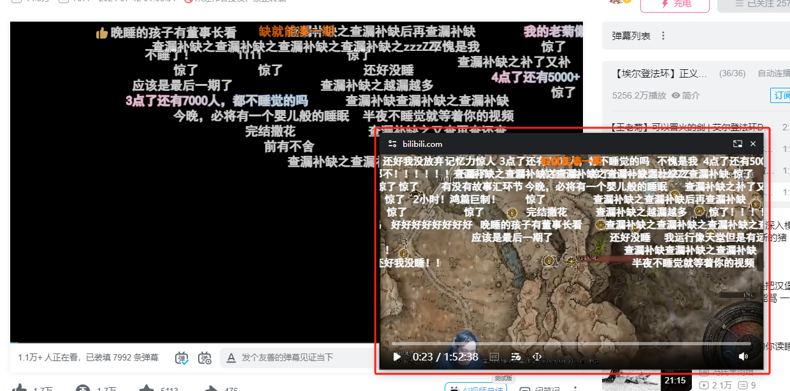
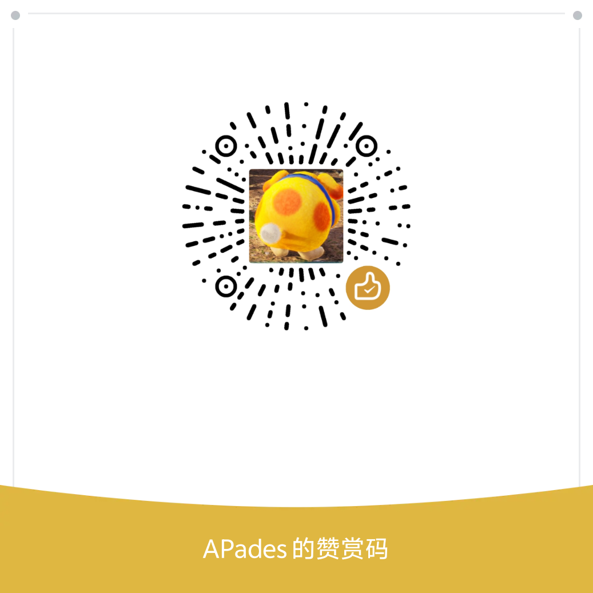

# 弹幕画中画播放器
<div align="center">

[](https://chrome.google.com/webstore/detail/nahbabjlllhocabmecfjmcblchhpoclj)
[](https://microsoftedge.microsoft.com/addons/detail/hohfhljppjpiemblilibldgppjpclfbl)
[](https://github.com/apades/dmMiniPlayer/releases/latest)

</div>

<p align="center" style="margin-bottom: 0px !important;">
<br/>
</p>

支持最新的画中画API功能，可以播放、发送弹幕，支持字幕，键盘控制进度，更好的画中画播放体验的浏览器插件

- [chrome商店](https://chrome.google.com/webstore/detail/nahbabjlllhocabmecfjmcblchhpoclj)
- [edge商店 更新比较慢，如果有什么紧急bug修复一般都要一周后才能上架](https://microsoftedge.microsoft.com/addons/detail/hohfhljppjpiemblilibldgppjpclfbl)
- [最新发布](https://github.com/apades/dmMiniPlayer/releases/latest)


在提问前可以先搜索issue是否有类似的问题，或者先看看[FAQ](https://github.com/apades/dmMiniPlayer/wiki/FAQ%E2%80%90zh)

如果你有什么问题或者功能提议，请到[issues](https://github.com/apades/dmMiniPlayer/issues)里提出

## 🚀 功能
- 拖拽或者键盘控制画中画窗口的进度条、音量、播放速率等
- 弹幕播放和发送
  - bilibili视频 + 直播
  - 斗鱼直播
  - 动画疯
  - 虎牙直播 *
  - youtube直播 *
  - twitch直播 *
  - 抖音直播 *
- 针对 bilibili、Youtube、Netflix 的特殊功能支持
  - 视频播放侧边栏，可直接在画中画里切换播放列表、推荐视频
  - 网站的字幕列表
  - 进度条的预览功能(Netflix暂不支持)
- 支持外挂.xml .ass弹幕文件，下载可以使用[Bilibili-Evolved](https://github.com/the1812/Bilibili-Evolved)或[ACG助手](https://chromewebstore.google.com/detail/kpbnombpnpcffllnianjibmpadjolanh)，也可以通过输入bilibili url的下载弹幕并播放
- 字幕功能
  - 支持.srt .ass外挂功能
  - 字幕翻译 + 双语功能
- 长按右键倍速，逐帧快进快退，截屏等功能 + 可自定快捷键
- 将网页视频播放器替换为扩展程序的视频播放器
- 支持绝大多数 https 网站，甚至支持类似Crunchyroll的[EME](https://web.dev/articles/media-eme)版权保护视频、Youtube 嵌入视频。

> [!NOTE]
> *标记为目前只有监听网页弹幕DOM模式，可能会有意料之外的问题

## How to Dev
### env
- pnpm >=10.0.0
- node >=24.11.0

> [!WARNING]
> If you are using Windows, please make sure you have Unix utils in your env (rm sh etc.)
> 
> Or use WSL, or download [cmder](https://cmder.app/)

### dev
```bash
pnpm i
pnpm run dev
```
Drag `dist` folder and drop to `chrome://extensions/` page in Chrome (Open development mode before)

### 可选：Longplay 商业分支桥模块

针对 [#167](https://github.com/apades/dmMiniPlayer/issues/167) 的「请求 → 桥 → 触发」设计，`packages/longplay-bridge` 提供可选的 VIP access 权益检查。现有播放器入口没有导入这个包，免费版不会因此发起 Longplay 请求、改变功能或增加运行时代码。

商业分支可以在扩展页或后台上下文中接入：

```ts
import { createLongplayBridge } from '@pkgs/longplay-bridge'

const bridge = createLongplayBridge({
  baseUrl: 'https://api.dev.longplayai.com',
  scope: { projectId: '<App UUID>', environment: 'sandbox' },
  onPurchaseRequired: async (featureId) => {
    // 由商业分支打开自己的 HTTPS 会员页，在网页里展示 Paywall / 完成结算。
    // featureId 只选择功能，不携带用户凭据，也不代表付款成功。
    await openMembershipPage(featureId)
  },
})

// 复用产品自身登录态：由可信后端验证用户并签发完整 Customer Session。
bridge.identify(await loadVerifiedCustomerSession())
const result = await bridge.request('<VIP access Feature UUID>', async () => {
  return runVipFeature()
})
// result.allowed 为 false 时不执行功能；购买后由用户重试同一请求。
// 退出登录调用 bridge.reset()；切换账号重新 identify；销毁时调用 destroy()。
```

`openMembershipPage`、`loadVerifiedCustomerSession` 和 `runVipFeature` 是商业分支提供的接入点，不是公开版已有的接口。App / Feature、产品用户登录与会员页也由商业分支配置；Longplay 控制台登录不能代替产品用户认证。服务端接入见 [Longplay 文档](https://longplayai.com/docs/server-auth)。Server Key 仅留在可信后端。

本桥仅处理 `access` 类型的 VIP 功能，不做按量扣费，也不把客户端检查当作受保护后端服务的授权。后端仍需独立检查权益；网络或认证失败会抛错，不会放行功能。购买页打开或返回后不会自动放行，下一次请求必须重新得到服务端授权。Session 只交给扩展可信上下文，不放进网页全局变量或消息广播。

Paywall / 结算放在普通网页中，扩展只使用打包的 SDK 数据层，不加载远程执行代码。若商业版增加账号、计费或数据采集，应同步更新该版本的隐私声明。当前公开版的 `privacy.txt` 不变。

针对桥模块的离线检查：

```bash
pnpm --filter @dm-mini-player/longplay-bridge test
pnpm --filter @dm-mini-player/longplay-bridge typecheck
```

## 📚 主要实现方法
### 旧版本PIP
用一个单独canvas画video + 弹幕，再把canvas的stream附加到一个单独的video上，最后开启画中画功能

### 新版本docPIP
使用了[documentPictureInPicture](https://developer.chrome.com/docs/web-platform/document-picture-in-picture/)该API，关于[技术细节在这](https://github.com/apades/dmMiniPlayer/wiki/tech%E2%80%90zh)

> [!NOTE]
> 该API是[非w3c草案功能](https://wicg.github.io/document-picture-in-picture/)，从chrome 116开始已经强推到stable上了，[非chromium](https://caniuse.com/?search=document-picture-in-picture)目前还没看到能用的，所以其他内核浏览器不打算支持
> 
> 如果你是360 qq浏览器这种套壳Chromium的且没有该API，地址栏到`chrome://flags/#document-picture-in-picture-api`查看是否支持开启

> [!WARNING]
> 如果你使用edge打开有红色tab栏，建议升级到`126.0.2592.102`版本以上


## 💖 引用代码
非常感谢这些项目的开源，让我抄了不少代码节省了很多时间

- [bilibili-evaolved](https://github.com/the1812/Bilibili-Evolved)
- [douyu-monitor](https://github.com/qianjiachun/douyu-monitor)
- [bilibili-API-collect](https://github.com/SocialSisterYi/bilibili-API-collect)
- [rc-slider](http://github.com/react-component/slider)
- [js-cookie](https://github.com/js-cookie/js-cookie)
- [esbuild-plugin-inline-import](https://github.com/claviska/esbuild-plugin-inline-import)
- [tsup](https://github.com/egoist/tsup/blob/796fc5030f68f929fecde7c94732e9a586ba7508/src/esbuild/postcss.ts)
- [tailwindcss-container-queries](https://github.com/tailwindlabs/tailwindcss-container-queries)
- [ts-key-enum](https://www.npmjs.com/package/ts-key-enum)
- [@ironkinoko/danmaku](https://github.com/IronKinoko/danmaku)
- [netflix-subtitle-downloader](https://greasyfork.org/en/scripts/26654-netflix-subtitle-downloader)

## 🍔 投喂
如果您很喜欢这个项目, 欢迎打赏, 金额随意. 您的支持是我的动力(=・ω・=)



> 🙏 thanks list
> 
> - 2025/3/4 我爱吃肉
> - 2025/6/9 zzzzz
> - 2025/7/2 真空
> - 2025/9/18 匿名用户

## 📜 License
[CC BY-NC 4.0](https://creativecommons.org/licenses/by-nc/4.0/)
